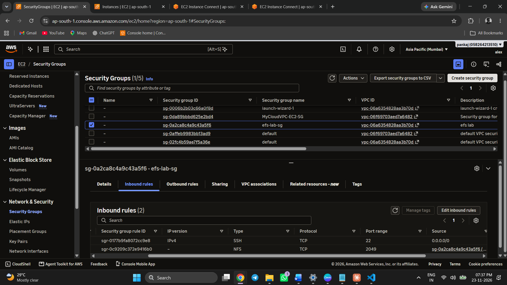
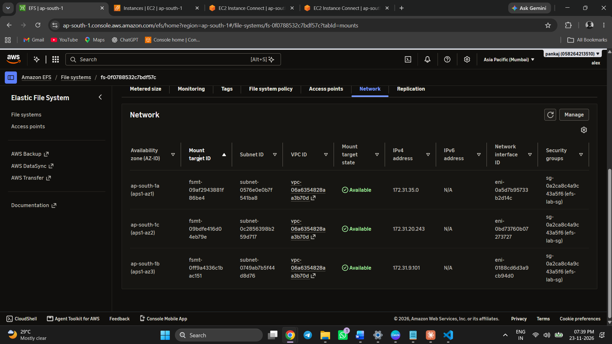
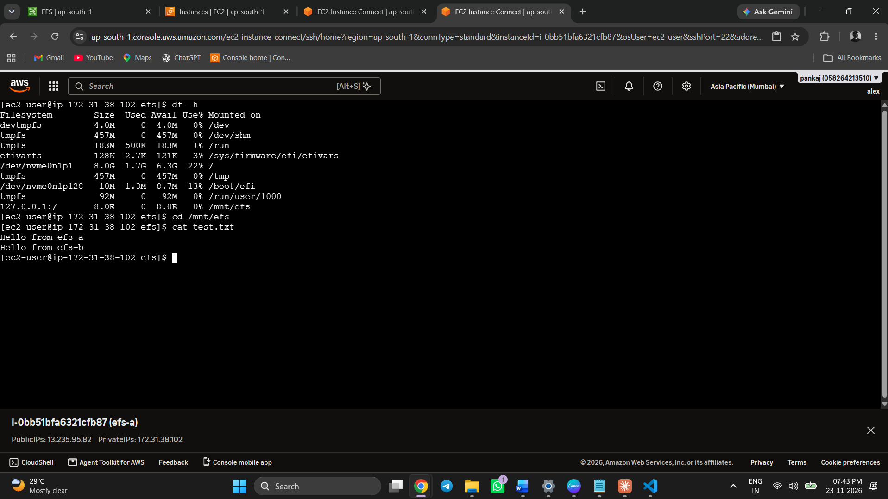
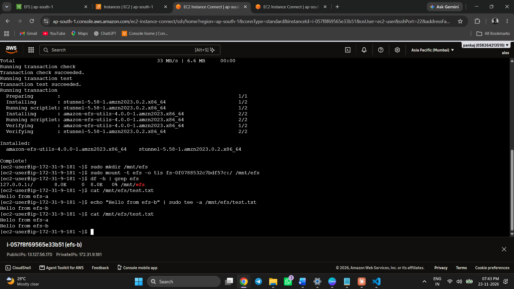

# AWS EFS Hands-On Lab

Share one **Amazon EFS** file system between two EC2 instances in different Availability Zones.

**Region:** ap-south-1 (Mumbai) | **OS:** Amazon Linux 2023 | **Type:** t3.micro

## Architecture

```
        Default VPC
  ┌───────────┐   ┌───────────┐
  │  efs-a    │   │  efs-b    │
  │ (AZ 1a)   │   │ (AZ 1b)   │
  └─────┬─────┘   └─────┬─────┘
        │ NFS 2049      │
  ┌─────▼─────┐   ┌─────▼─────┐
  │ Mount     │   │ Mount     │
  │ target 1a │   │ target 1b │
  └─────┬─────┘   └─────┬─────┘
        └───────┬───────┘
          EFS file system
```

## What is EFS?

A managed, shared network file system (NFS) for Linux. It grows and shrinks automatically and can be mounted on many instances at once.

| | EFS | EBS | S3 |
|---|---|---|---|
| Type | Shared file system | Block disk | Object storage |
| Attach to | Many instances, many AZs | One instance, one AZ | API access |
| Capacity | Elastic | Fixed | Unlimited |

## Steps

**1. Security group `efs-lab-sg`** (default VPC)
- Inbound: SSH (22) from `13.233.177.0/29` (EC2 Instance Connect, Mumbai)
- Inbound: NFS (2049) from `efs-lab-sg` itself
- Outbound: All traffic to `0.0.0.0/0`

**2. Create EFS** (Customize)
- Name `my-efs`, Regional, Elastic throughput, encryption on
- Mount targets in the default VPC, security group `efs-lab-sg` on every AZ

**3. Launch two EC2 instances**
- `efs-a` in ap-south-1a, `efs-b` in ap-south-1b
- Amazon Linux 2023, public IP enabled, security group `efs-lab-sg`

**4. Mount on both instances**
```bash
sudo yum install -y amazon-efs-utils
sudo mkdir /mnt/efs
sudo mount -t efs -o tls <fs-id>:/ /mnt/efs
df -h | grep efs
```

**5. Prove it is shared**
```bash
# efs-a
echo "Hello from efs-a" | sudo tee /mnt/efs/test.txt

# efs-b
cat /mnt/efs/test.txt
echo "Hello from efs-b" | sudo tee -a /mnt/efs/test.txt
```
Both lines appear on both instances.

**6. Persist across reboots**
```bash
echo "<fs-id>:/ /mnt/efs efs _netdev,tls 0 0" | sudo tee -a /etc/fstab
sudo mount -a
```

## Screenshots

**Security group rules**


**EFS mount targets (2 AZs)**


**efs-a: mounted and file written**


**efs-b: same file visible, shared**


## Troubleshooting

| Problem | Cause | Fix |
|---|---|---|
| Instance Connect: "Failed to connect" | SSH source was "My IP" | Use `13.233.177.0/29` |
| Same error in a custom VPC | No internet gateway or route | Use default VPC, or add `0.0.0.0/0` to an IGW |
| `yum install` times out | Outbound rule only allowed SSH | Outbound: All traffic to `0.0.0.0/0` |
| `mount` hangs, then times out | Mount target uses the wrong security group | Set `efs-lab-sg` on each mount target |

## Key Terms

- **EFS:** managed shared NFS file system
- **Mount target:** per-AZ network endpoint of EFS
- **NFS (port 2049):** protocol used to mount EFS
- **Security group:** stateful firewall on an instance or mount target
- **amazon-efs-utils:** mount helper that adds `-t efs` and TLS
- **EC2 Instance Connect:** browser SSH, connects from AWS's IP range
- **fstab:** file that remounts the file system at boot

## Cleanup

1. Terminate `efs-a` and `efs-b`
2. Delete the EFS file system
3. Delete `efs-lab-sg`

## Notes

Never commit access keys, key pairs, or account IDs.
